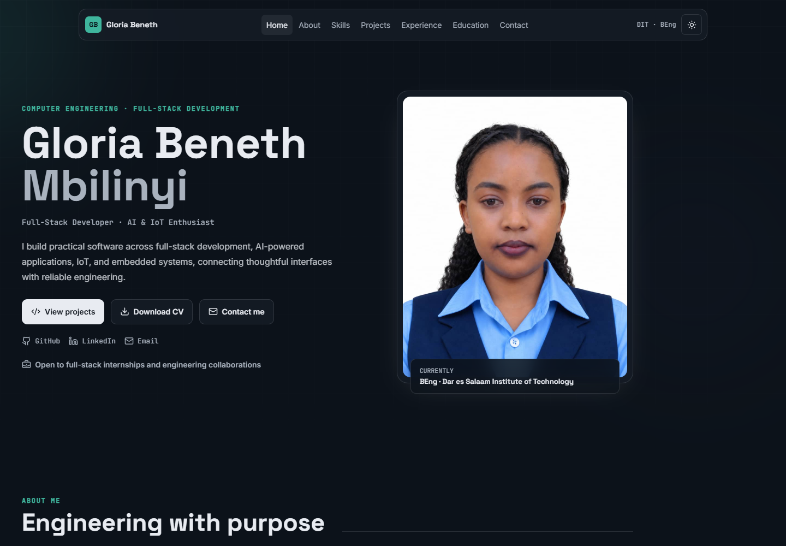
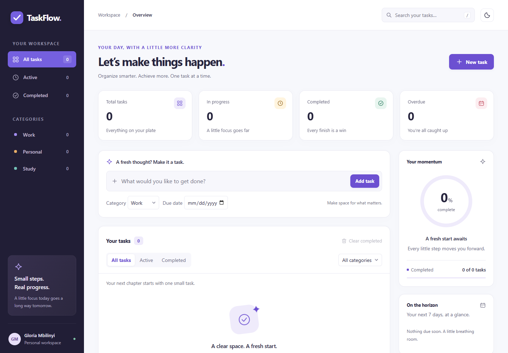
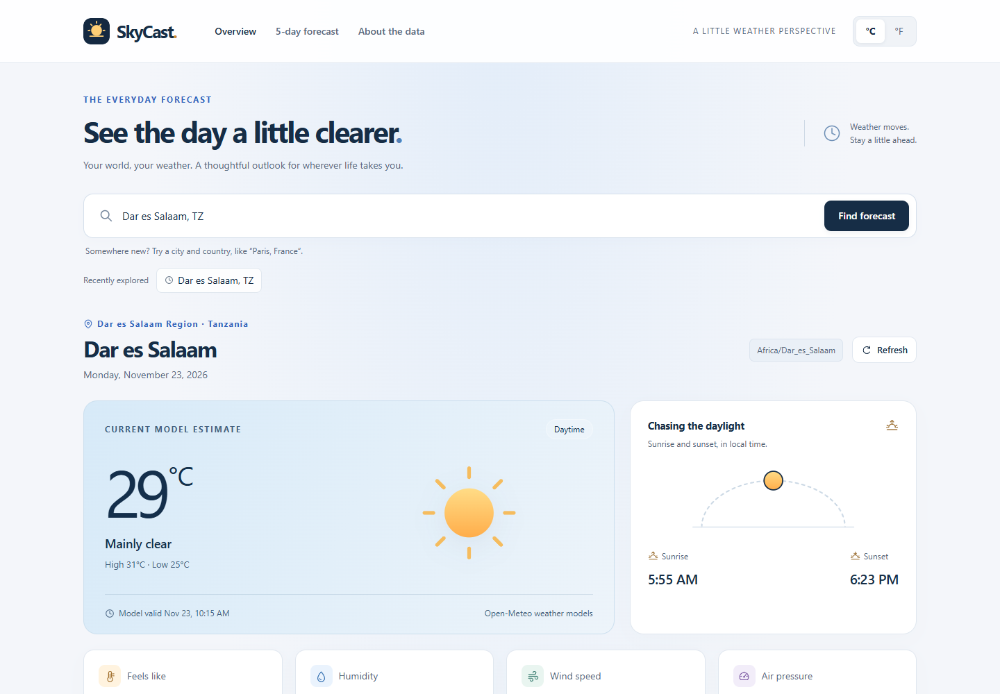
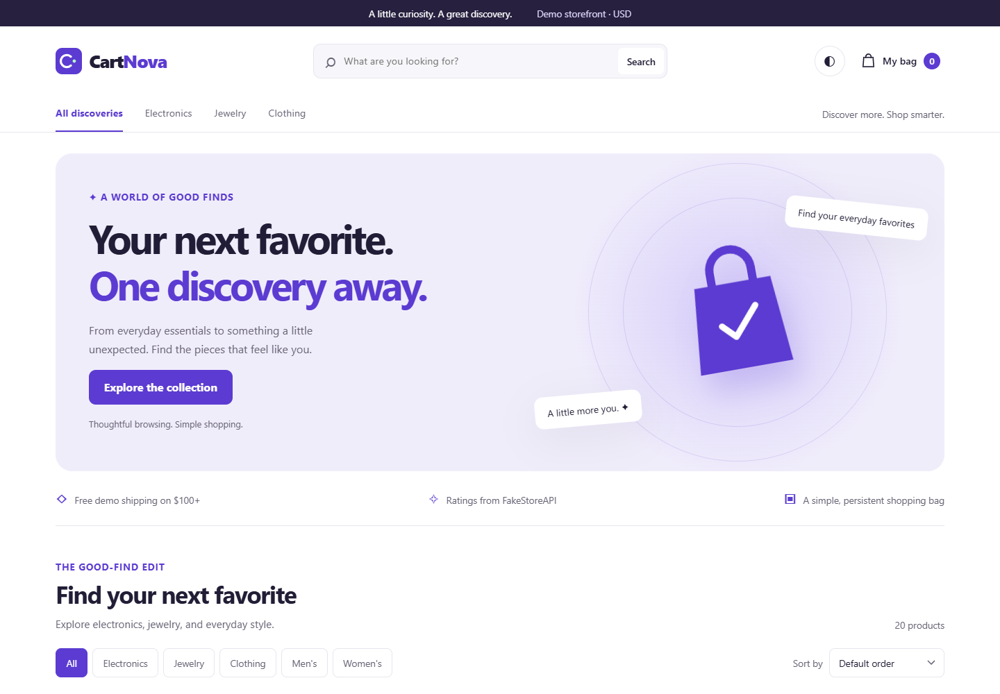

# Datheon Full Stack Web Development Internship

## Final project submission · Batch 01

**Gloria Beneth Mbilinyi** · Dar es Salaam Institute of Technology (DIT)

[GitHub profile](https://github.com/gloria-mbilinyi) · [LinkedIn](https://www.linkedin.com/in/gloria-mbilinyi/) · [Final submission report](docs/SUBMISSION_REPORT.md) · [Consolidated CI](https://github.com/gloria-mbilinyi/Datheon_Full_Stack_Web_Development_Internship/actions)

Four completed projects demonstrating personal presentation, browser-local task management, live weather integration, and a persistent shopping experience. This repository contains the **actual project source, assets, lockfiles, tests, and task READMEs** required to inspect and run each project independently.

The projects remain separately deployed and independently maintained. This repository is the consolidated source submission, rather than a single combined website.

## Projects and verified source provenance

| Task | Source directory | Original repository | Verified source commit |
| --- | --- | --- | --- |
| 1 | [Task-1-Developer-Portfolio](Task-1-Developer-Portfolio/) | [gloria-portfolio](https://github.com/gloria-mbilinyi/gloria-portfolio) | [`9b17eef44ad81ea6e3ed78181e3af66cf710a4ad`](https://github.com/gloria-mbilinyi/gloria-portfolio/commit/9b17eef44ad81ea6e3ed78181e3af66cf710a4ad) |
| 2 | [Task-2-Dynamic-Task-Manager](Task-2-Dynamic-Task-Manager/) | [taskflow-datheon](https://github.com/gloria-mbilinyi/taskflow-datheon) | [`3b4eafbfd6861af5fca0b3e282e090aac5bbd416`](https://github.com/gloria-mbilinyi/taskflow-datheon/commit/3b4eafbfd6861af5fca0b3e282e090aac5bbd416) |
| 3 | [Task-3-Weather-Forecast](Task-3-Weather-Forecast/) | [skycast-datheon](https://github.com/gloria-mbilinyi/skycast-datheon) | [`45cae97fa3c96e83c755bbf9161bab1ca25e6379`](https://github.com/gloria-mbilinyi/skycast-datheon/commit/45cae97fa3c96e83c755bbf9161bab1ca25e6379) |
| 4 | [Task-4-Ecommerce-Shopping-Cart](Task-4-Ecommerce-Shopping-Cart/) | [cartnova-datheon](https://github.com/gloria-mbilinyi/cartnova-datheon) | [`fb84900dcef48eca915fc0d1a132f04e12e07f16`](https://github.com/gloria-mbilinyi/cartnova-datheon/commit/fb84900dcef48eca915fc0d1a132f04e12e07f16) |

Source exports were made from these commits using `git archive`. UTF-8 CRLF line endings were normalized to LF for a consistent cross-platform checkout; application code and assets were otherwise preserved. [Per-file manifests](docs/source-manifests/) record both original blob hashes and imported-file hashes for **251 source files**.

**Original commit histories remain in the original repositories.** This repository records genuine source-assembly and verification commits; it does not claim to preserve all original histories. No original repository was modified, deleted, force-pushed, or redeployed during assembly.

## Task 1 · Personal Developer Portfolio

**Problem:** Give reviewers, recruiters, and collaborators one accessible place to understand Gloria's skills, education, technical work, and contact options.

**Features:** Personal introduction and About sections; categorized skills; nine real project entries with category filters and detail dialogs; education/experience; downloadable CV; contact actions; responsive navigation; persistent light/dark theme; reduced-motion support and metadata.

**Technology:** React 19, TypeScript, TanStack Start/Router, Vite 8, Tailwind CSS 4, Motion, React Hook Form/Zod, Lucide, and Nitro. Hosted on Cloudflare Workers.

[Live portfolio](https://gloria-mbilinyi-gloria-portfolio.gloria-portfolio-tz.workers.dev/) · [Task README](Task-1-Developer-Portfolio/README.md)



## Task 2 · Dynamic Task Manager — TaskFlow

**Problem:** Keep tasks, due dates, priorities of attention, and completion progress visible in one dependable browser workspace.

**Features:** Create, read, edit, complete/reopen, and delete tasks; Work/Personal/Study categories; due dates and overdue indicators; combined status/category/search filters; persistent ordering through drag-and-drop or accessible move controls; statistics and upcoming tasks; localStorage recovery/backup handling; responsive light/dark UI.

**Technology:** HTML5, CSS3 Grid/Flexbox, vanilla JavaScript modules, localStorage, Node.js, Playwright, and axe-core. Static hosting on GitHub Pages.

[Live TaskFlow](https://gloria-mbilinyi.github.io/taskflow-datheon/) · [Task README](Task-2-Dynamic-Task-Manager/README.md)



## Task 3 · Weather Forecast and Climate Telemetry — SkyCast

**Problem:** Find the correct city among similarly named locations, then present current weather estimates and a five-day outlook with clear provenance and missing/stale-data handling.

**Features:** Explicit city selection; live Open-Meteo geocoding and forecast requests; current conditions and five daily cards; sunrise/sunset and trend chart; Celsius/Fahrenheit conversion; weather themes; recent cities/preferences; safe stale-cache labeling; cancellation, timeouts, error/retry states, and accessible suggestions.

**Technology:** HTML5, CSS3, vanilla JavaScript modules, Fetch/AbortController, localStorage, Open-Meteo/GeoNames, Node.js, Playwright, and axe-core. Static hosting on GitHub Pages.

Current conditions are weather-model estimates. The project does not claim physical sensor telemetry or historical climate analysis.

[Live SkyCast](https://gloria-mbilinyi.github.io/skycast-datheon/) · [Task README](Task-3-Weather-Forecast/README.md)



## Task 4 · E-Commerce Catalog and Shopping Cart — CartNova

**Problem:** Let visitors explore live product data and maintain a consistent, persistent shopping bag through filtering, quantity changes, totals, and a transparent checkout simulation.

**Features:** Validated FakeStoreAPI products, images, prices and ratings; combined search/category/sort controls; product details; slide-out bag; add/remove and quantity changes; versioned persistence and cross-tab updates; integer-cent calculations; simulated checkout and local confirmation; error/retry/image-fallback states; responsive themes and keyboard focus management.

**Technology:** HTML5, CSS3, vanilla JavaScript modules, Fetch/AbortController, FakeStoreAPI, localStorage, Node.js, Playwright, and axe-core. Static hosting on GitHub Pages.

**Demo policy:** USD, 8% tax rounded to the nearest cent, $5 shipping for nonempty orders below $100, free shipping from $100, and $0 for an empty bag. Quantities are 1–99; decrementing 1 removes the line. **Demo checkout only — no payment or real order is processed.** Customer form fields are not persisted or submitted externally.

[Live CartNova](https://gloria-mbilinyi.github.io/cartnova-datheon/) · [Task README](Task-4-Ecommerce-Shopping-Cart/README.md)



## Screenshots and live verification

The screenshots above and [mobile captures](docs/screenshots/) were taken from the actual deployed websites on **23 November 2026**. The [live verification record](docs/evidence/live-demos.json) records HTTP 200 for all four sites, desktop/mobile widths, browser titles, zero observed JavaScript runtime errors, and unmocked API checks. SkyCast returned five days and a displayed temperature matching its API response; CartNova returned 20 products. Original project screenshots remain in their respective source folders.

## Repository structure

```text
Datheon_Full_Stack_Web_Development_Internship/
  Task-1-Developer-Portfolio/       React/TypeScript source, assets, tests and README
  Task-2-Dynamic-Task-Manager/      TaskFlow source, tests, scripts and README
  Task-3-Weather-Forecast/          SkyCast source, tests, scripts and README
  Task-4-Ecommerce-Shopping-Cart/   CartNova source, tests, scripts and README
  docs/
    screenshots/                  Fresh actual desktop/mobile captures
    evidence/                     Local, live, original CI and integrity records
    source-manifests/              Source SHAs and per-file hashes
    SUBMISSION_REPORT.md
  scripts/                        Consolidation integrity/live QA tooling
  .github/workflows/verify.yml     Independent project and integrity jobs
  README.md
  .gitignore
```

Nested `.github/workflows/` files are retained from each original repository as documentation. GitHub discovers the root workflow for this consolidated repository. It checks the source rather than deploying over any original site.

## Install and run each task

Use **Node.js 24** and npm. Clone this final repository, then work inside the required task folder; each package manifest and lockfile remains independent.

```sh
git clone https://github.com/gloria-mbilinyi/Datheon_Full_Stack_Web_Development_Internship.git
cd Datheon_Full_Stack_Web_Development_Internship
```

| Task | Install and start, from its folder | Local address |
| --- | --- | --- |
| Portfolio | `npm ci` then `npm run dev` | URL printed by Vite, normally port 3000 |
| TaskFlow | `npm ci` then `npm start` | http://127.0.0.1:4173/ |
| SkyCast | `npm ci` then `npm start` | http://127.0.0.1:4273/ |
| CartNova | `npm ci` then `npm run dev` | http://127.0.0.1:4373/ |

For example:

```sh
cd Task-2-Dynamic-Task-Manager
npm ci
npm start
```

The three vanilla apps can serve without npm installation; installation is needed for their development test dependencies. Use HTTP rather than opening module-based HTML with `file:`. Portfolio asset paths expect a site hosted at its own origin root; run its Vite server from its folder. No secret API keys are required for the four supplied applications.

## Tests rerun in this consolidated repository

These results were executed from the new task directories, separately from the evidence retained in the original project READMEs.

| Project | Checks rerun here | Unit/HTTP tests | Browser verification | Build |
| --- | --- | --- | --- | --- |
| Portfolio | TypeScript, ESLint, Prettier and portfolio content/CV checks | Custom assertion script passed; no invented test count | Supplementary Playwright checks passed for theme, project filtering/details, CV and mobile navigation | Passed |
| TaskFlow | Source checks | **28 passed** | **20 original Playwright tests passed** | Passed |
| SkyCast | Source checks | **34 passed** | **23 original Playwright tests passed** | Passed |
| CartNova | Source checks | **40 passed** | **31 original Playwright tests passed** | Passed |

Evidence: [local test command results](docs/evidence/local-tests.json) · [portfolio supplementary browser checks](docs/evidence/portfolio-local-browser.json).

The initial Windows Chrome launch failed in its crash-reporting helper, before tests could run. The three original vanilla Playwright suites were rerun with unchanged assertions using [the Windows launch adapter](scripts/windows-playwright.config.mjs) and separately managed local previews. Their normal configs are preserved. The portfolio's original custom CDP browser script could not start its default Chrome in this sandbox; the separate Playwright checks above passed instead. This limitation is not reported as an original-script pass.

Normal commands from each task folder:

```sh
# Portfolio
npm run check
npm run build
# Optional original browser script: start Vite on port 4180 first
npm run qa:browser

# Each vanilla application
npm run test:all
npm run build
```

On Linux, install the Playwright browser with `npx playwright install --with-deps chromium`. On ordinary Windows, the original suites use installed Chrome. If the same crashpad restriction occurs, start that task's server and, from the repository root in PowerShell, use:

```powershell
$env:SUBMISSION_PROJECT = 'Task-2-Dynamic-Task-Manager'
$env:SUBMISSION_EXTERNAL_PREVIEW = '1'
node Task-2-Dynamic-Task-Manager/node_modules/@playwright/test/cli.js test --config scripts/windows-playwright.config.mjs
```

Set the project and CLI path to Task 3 or Task 4 as appropriate. The adapter changes browser launch/preview management only. For optional fresh live evidence, install Task 4's development dependencies and run `node scripts/verify-live.mjs` from the root. Add `--local-portfolio` only with its Vite preview running on port 4180. Browser QA uses isolated contexts and never submits a contact email, real payment, or real order.

## Source integrity and credential exclusions

Run from the repository root:

```sh
node scripts/verify-submission.mjs
```

This verifies imported file hashes, source commit formats, project READMEs/lockfiles, relative references, local documentation links, and tracked-file exclusions. It rejects nested Git metadata, dependency/build/test-report directories, private environment files, recognizable credential formats, and personal machine paths. Generated build references in tests are distinguished from required source assets. It is a scoped integrity/credential-pattern check, not a claim of an exhaustive security audit.

Dependencies, build caches, generated output and temporary test reports are ignored. The portfolio's intentionally public developer contact content and CV are retained as project assets; no private credentials or customer records are added.

## CI/CD and deployment evidence

The original workflows succeeded at all four pinned source commits:

| Project | Original workflow evidence | Verified result |
| --- | --- | --- |
| Task 1 | [Portfolio quality checks](https://github.com/gloria-mbilinyi/gloria-portfolio/actions/runs/45071768269) | success |
| Task 2 | [Verify and deploy TaskFlow](https://github.com/gloria-mbilinyi/taskflow-datheon/actions/runs/45113177904) | success |
| Task 3 | [Verify and deploy SkyCast](https://github.com/gloria-mbilinyi/skycast-datheon/actions/runs/45121732097) | success |
| Task 4 | [Verify and deploy CartNova](https://github.com/gloria-mbilinyi/cartnova-datheon/actions/runs/45127728445) | success |

[Original repository/CI metadata and 18 verified GitHub links](docs/evidence/original-repositories.json).

The [root CI workflow](.github/workflows/verify.yml) checks integrity in a clean checkout and runs four independent project jobs with Node.js 24, locked dependencies, source checks and builds. The three vanilla jobs also run their complete deterministic Chromium suites. Portfolio CI runs its source-quality suite and build; its supplementary local/live browser evidence is separate. Permissions are read-only and there are no deployment secrets in this repository.

Portfolio remains hosted on Cloudflare Workers. TaskFlow, SkyCast, and CartNova remain on their original free HTTPS GitHub Pages deployments. This final repository does not alter those deployment settings.

## Known limitations

- Weather and product browsing depend on external public APIs and image availability. Clear error/retry states are implemented; generated fixtures are used only by tests.
- SkyCast displays model estimates and forecasts, with saved responses labeled stale. It does not provide physical-sensor or historical-climate measurements.
- CartNova checkout is a local simulation, with illustrative tax/shipping rules and no real commerce backend.
- TaskFlow tasks, shopping bags, preferences, and saved weather belong to a browser/profile/origin. Blocked or cleared storage limits persistence.
- The portfolio contact action prepares an email using the visitor's mail client; it is not a server-side email delivery service.
- Browser checks cover Chrome/Chromium and specified responsive widths, rather than every browser/assistive technology. The portfolio's original CDP-script startup limitation is disclosed above.

## Submission checklist

- [x] All four complete source directories, task READMEs, assets, tests, manifests and lockfiles included.
- [x] Original repository URLs and verified source commit SHAs recorded.
- [x] Original histories and independent deployments preserved.
- [x] Imported sources/builds tested independently; local and historical results distinguished.
- [x] Actual screenshots, unmocked live checks and CI evidence included.
- [x] Credential, dependency, cache, temporary-report and nested-Git exclusions checked.
- [x] [Final submission report](docs/SUBMISSION_REPORT.md) included.
- [ ] Datheon portal form submitted by the developer after review.

This repository prepares the engineering submission. It does not claim Datheon certification, Directorate approval, or portal submission.
